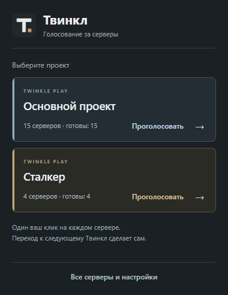

# Твинкл: помощник голосования

Версия 0.2.0. 15 серверов основного проекта Twinkle Play и 4 сервера Сталкера уже добавлены. Исходники открыты по лицензии MIT.



## Как пользоваться

1. Нажмите на значок Твинкл.
2. Выберите «Проголосовать за основной проект» или «Проголосовать за Сталкер».
3. Откроется раздел голосования первого сервера. Дождитесь, пока WARGM активирует кнопку.
4. Сами нажмите «ГОЛОСОВАТЬ». Если сайт требует вход или проверку, пройдите их самостоятельно.
5. Когда после вашего нажатия WARGM покажет таймер, Твинкл сохранит результат и откроет следующий сервер в той же вкладке.
6. После последнего сервера откроется список с итогом прохода.

Если таймер уже есть при открытии сервера, Твинкл сохранит оставшееся время и пропустит сервер. Новый голос при этом не записывается. Расширение читает таймер только в карточке «Голосование», включая формат `15ч. 60м.`. Ошибка, исчезновение кнопки или просто обновление страницы не считаются подтверждением.

Кнопки «Пропустить» и «Остановить» находятся в небольшой панели на WARGM. Пропуск не создаёт отметку о голосе. После закрытия вкладки или перезапуска браузера продолжите через значок Твинкл. Если результат не распознан, расширение остаётся на текущей странице.

Напоминания и уведомления включаются отдельно в настройках. В обычном режиме таймер сам не начинает проход. Можно вручную открыть сервер и поставить личную отметку «Я проголосовал», отменить её или отложить напоминание на час.

[Все 19 ссылок](docs/SERVERS.md). Деление на основной проект и Сталкер привязано к адресам серверов, поэтому переименование его не меняет. При обновлении сохраняются список и таймеры. Удалённые после добавления серверы сами не возвращаются. Лимит списка: 19 серверов.

## Скачать и установить

[Скачать расширение](https://github.com/ZoOm37rus/twinkle-vote/releases/download/v0.2.0/Twinkle-0.2.0-chrome.zip)

1. Распакуйте архив в постоянную папку.
2. Откройте `chrome://extensions` и включите «Режим разработчика».
3. Нажмите «Загрузить распакованное расширение» и выберите эту папку.
4. Закрепите Твинкл в меню расширений браузера.

Для обновления замените файлы в той же папке файлами нового архива и нажмите кнопку обновления на карточке Твинкл. Не удаляйте расширение, чтобы не потерять данные. В версии 0.2.0 появился доступ к WARGM для чтения кнопки и таймера. Если браузер попросит подтвердить его, разрешите доступ к WARGM.

Если скачали исходники, выбирайте папку `extension`. В Chrome Web Store расширение пока не опубликовано.

## Прозрачность

Твинкл не нажимает кнопку голосования и не отправляет запросы голосования. Переходы запускаются выбранным пользователем проходом. Подтверждение определяется по видимому таймеру WARGM после реального клика, а не через отдельный API сервера. Это не независимая проверка начисления бонусов. Если WARGM изменит разметку, распознавание может потребовать обновления.

Данные хранятся в браузере: серверы, настройки, отметки, оставшееся время, текущий проход и последние 80 действий. Нет аналитики, удалённого кода, рекламы и серверной части. Cookie, пароли и история посещений не читаются. Сохранение списка в файл переносит только названия и ссылки.

[Политика конфиденциальности](PRIVACY.md). Расширение написано самостоятельно и не связано с WARGM официально. Код Auto Vote Rating не включён.

## Для разработчиков

Node.js 24+ и Python 3.10+ нужны только для разработки и сборки.

```sh
npm ci
npm test
npx playwright install chromium
npm run test:browser
npm run test:tour
python scripts/build.py
```

Браузерные проверки используют отдельные профили. Проверка прохода подменяет страницы WARGM локальными примерами: внешние запросы блокируются, реальные голоса не отправляются. Проверены кнопки, обновление страницы, разные таймеры, отсутствие автоматического клика, защита от повторной отметки, пропуск, остановка и сохранение состояния. Реальное голосование с авторизацией на WARGM ещё не проверено. [Подробнее о проверке](docs/VALIDATION.md).

Сборка создаёт архив расширения, исходники и `SHA256SUMS.txt` в `dist`. Зависимости разработки, профили браузеров и результаты тестов в архив исходников не входят.

## Поддержка

[Сообщить о проблеме](https://github.com/ZoOm37rus/twinkle-vote/issues). Укажите версию расширения и текст ошибки. Не публикуйте пароли, cookie и данные входа.
