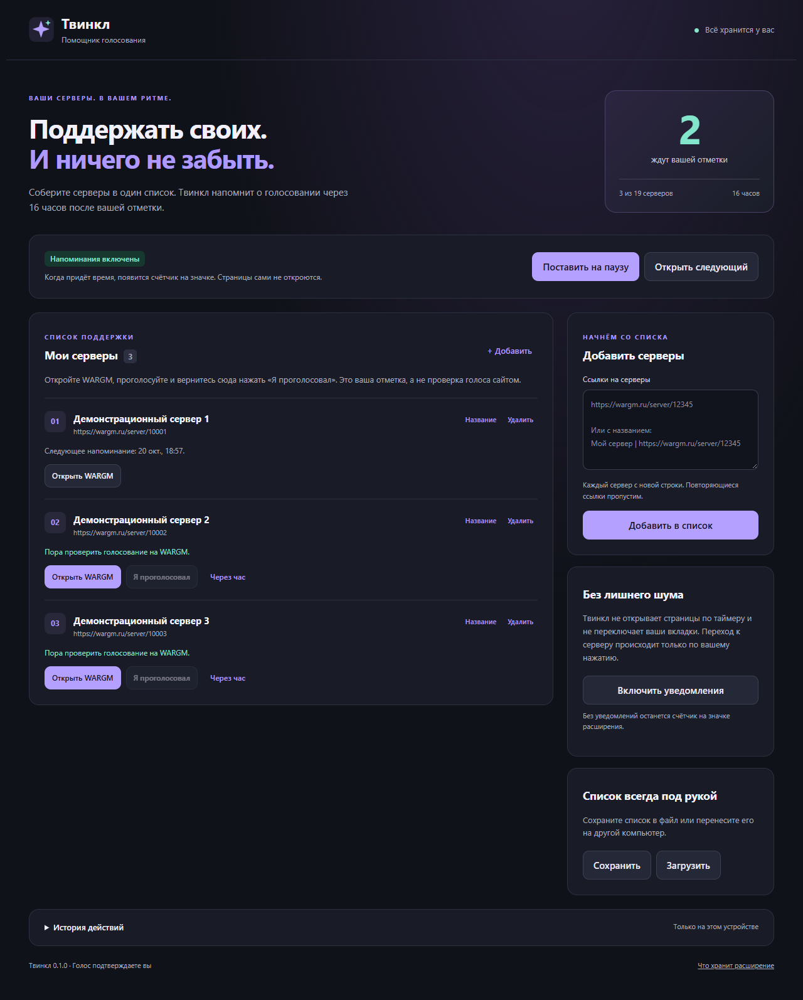

# Твинкл: помощник голосования

Серверы WARGM в одном списке, напоминания через 16 часов и переход к ручному голосованию.

Это первая версия 0.1.0. Исходники открыты по лицензии MIT. Расширение написано самостоятельно, код Auto Vote Rating не включён.



## Как пользоваться

1. Добавьте ссылки на свои серверы WARGM. Можно вставить сразу 19 строк.
2. Нажмите «Начать напоминания». При желании отдельно включите уведомления.
3. Нажмите «Открыть следующий». Откроется одна страница WARGM.
4. Проголосуйте на сайте, затем вернитесь в Твинкл и нажмите «Я проголосовал».
5. Следующее напоминание для этого сервера появится через 16 часов от вашей отметки.

Если голосовать пока нельзя, нажмите «Через час». Если случайно отметили голос, нажмите «Отменить отметку».

Твинкл не отправляет голоса и не проверяет их принятие. Отметка означает только ваше подтверждение. Доступность голосования и его ограничения определяет WARGM. Расширение не связано с WARGM официально.

Автоматические события обновляют счётчик и показывают напоминание. Вкладка открывается и получает внимание только после вашего нажатия. Открытые страницы не закрываются автоматически: прочитайте результат на WARGM и закройте вкладку сами.

Если компьютер спит или браузер закрыт, напоминание может прийти позже. При следующем запуске расписание восстанавливается. Прошедшие интервалы не создают очередь повторных уведомлений.

## Установка для проверки

1. Распакуйте `dist/Twinkle-0.1.0-chrome.zip` в отдельную папку.
2. Откройте в Chrome адрес `chrome://extensions`.
3. Включите «Режим разработчика».
4. Нажмите «Загрузить распакованное расширение» и выберите эту папку.
5. В меню расширений закрепите Твинкл. Нажатие на его значок открывает список серверов.

Если вы скачали исходники, выбирайте папку `extension`, а не корень репозитория.

После публикации в Chrome Web Store режим разработчика не понадобится. На момент подготовки этой версии расширение ещё не опубликовано.

## Ваши данные

- Настройки, список, время ваших отметок и последние 80 действий хранятся локально.
- Нет аналитики, удалённого кода, рекламы и серверной части.
- Нет доступа к содержимому сайтов, cookie, паролям и истории посещений.
- Сохранение в файл переносит только названия и ссылки. Существующие записи не заменяются.
- Удаление расширения удаляет его локальные данные. Экспортированные файлы удаляются отдельно.

Подробности: [политика конфиденциальности](PRIVACY.md).

## Для разработчиков

Требования: Node.js 24+ и Python 3.10+. Для работы самого расширения они не нужны.

```sh
npm ci
npm test
python scripts/build.py
```

У расширения нет сторонних зависимостей во время работы. Playwright используется только в проверках интерфейса.

Для браузерной проверки:

```sh
npx playwright install chromium
npm run test:browser
```

После браузерной проверки материалы магазина обновляются командой `node scripts/store_assets.mjs`.

Тест запускается в отдельном профиле. Адрес новой вкладки заменяется на `about:blank` внутри теста, а запрошенный адрес проверяется отдельно. Реальные голоса, авторизация и серверные настройки не затрагиваются. Проверка создаёт папки `.tools` и `test-results`, которые не входят в архив исходников.

Архивы собираются в `dist` с постоянными временными метками файлов. Рядом лежит `SHA256SUMS.txt`. Две сборки одних и тех же файлов дают одинаковые архивы в одинаковом окружении Python/zlib.

Основные файлы:

- `extension/model.js`: список, проверка ссылок, отметки и расписание.
- `extension/background.js`: сохранение, таймеры, уведомления, открытие страницы по нажатию.
- `extension/app.js`: интерфейс и сообщения игроку.
- `tests`: проверки логики и интерфейса.
- `docs/PUBLISH.md`: публикация GitHub и Chrome Web Store.
- `docs/STORE_LISTING.md`: текст карточки магазина.
- `docs/VALIDATION.md`: результаты и границы проверки.

Иконки оригинальные. Готовые PNG включены в исходники. Для их повторной генерации нужен Pillow: `python scripts/make_icons.py`.

## Поддержка

После размещения репозитория используйте его раздел Issues. В отчёте достаточно версии расширения, названия браузера и текста ошибки. Не публикуйте пароли, cookie, данные входа и личные ссылки.
